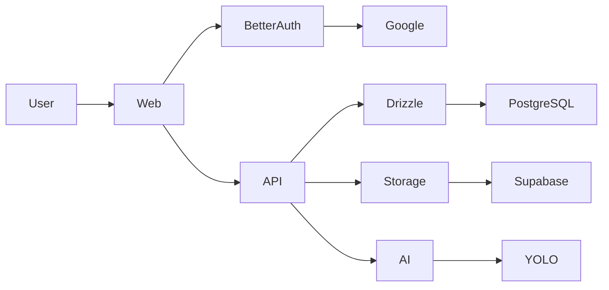

# 🌿 EcoVision — AI-Powered Waste & E-Waste Analysis Platform

EcoVision is an end-to-end full-stack platform designed to analyze images of discarded items using computer vision. It detects objects, classifies their waste category, identifies whether each item constitutes **Electronic Waste (E-waste)**, provides confidence scores with visual bounding boxes, delivers actionable recycling/disposal guidance, and records historical telemetry for auditability and insights.

---

## 📐 Architecture Overview

EcoVision follows a **clean monorepo architecture** orchestrated via **pnpm workspaces** and **Turborepo**, without introducing arbitrary shared package layers. Each service is independently containerized and deployable.



### Monorepo Structure

```text
ecovision/
│
├── apps/
│   ├── web/              # Next.js 16 frontend (App Router, Tailwind, shadcn/ui, TanStack Query)
│   ├── api/              # Express.js backend (TypeScript, Drizzle ORM, Better Auth, Multer)
│   └── ai/               # Python FastAPI AI microservice (Pydantic, WasteDetector, Mock & YOLO)
│
├── docker-compose.yml
├── package.json
├── pnpm-workspace.yaml
├── turbo.json
├── README.md
└── .gitignore
```

> [!IMPORTANT]
> **No `packages/` directory**: Each application contains its own types, schemas, and configurations. Small DTO duplications preserve independent deployability and eliminate brittle inter-package version coupling.

---

## 🛠️ Tech Stack

| Layer | Technologies |
| :--- | :--- |
| **Frontend** (`apps/web`) | Next.js 16 (App Router, Turbopack), React 19, TypeScript, Tailwind CSS, shadcn/ui, TanStack Query v5, Lucide React |
| **Backend API** (`apps/api`) | Node.js, Express.js, TypeScript, PostgreSQL, Drizzle ORM, Better Auth (Google OAuth), Multer, Zod, Helmet, CORS |
| **AI Service** (`apps/ai`) | Python 3.11+, FastAPI, Pydantic, Pillow, Uvicorn, Ultralytics YOLO (optional) |
| **Orchestration & Tooling** | Turborepo, pnpm workspaces, Docker, Docker Compose |
| **Storage & Persistence** | PostgreSQL, Supabase Storage (with `LocalFileStorageService` fallback) |

---

## ✨ Features

- **Waste Detection**: Detects single or multiple waste objects in uploaded photos.
- **E-Waste Classification**: Automatically classifies objects as electronic waste (hazardous/regulated) or general recyclables.
- **Visual Bounding Boxes**: Overlays bounding boxes on images with color-coded categories, confidence percentages, and coordinate telemetry.
- **Actionable Recycling Advice**: Generates item-specific stewardship advice (e.g., lithium-ion fire hazard warnings, battery taping, confidential data wiping).
- **Interactive Analytics Dashboard**: Live metrics tracking total analyses, e-waste proportion percentages, and category distribution charts.
- **Searchable & Filterable History**: Full audit trail allowing users to search by category, filter by waste type, sort by date, and manage analyses.
- **Pluggable AI Architecture**: Decoupled `WasteDetector` abstraction allowing zero-downtime swap from `MockWasteDetector` to a fine-tuned `YOLOWasteDetector`.
- **Flexible Storage**: Storage layer abstraction (`FileStorageService`) supporting Supabase Storage for production and Local Disk Storage for offline development.

---

## 📦 Waste Categories Supported

### Electronic Waste (E-Waste)
- Mobile phone
- Laptop
- Tablet
- Monitor
- Keyboard
- Mouse
- Printer
- Charger
- Power adapter
- Cable
- Battery
- Computer components
- Other electronic device

### Non E-Waste
- Plastic
- Paper
- Cardboard
- Glass
- Metal
- Food waste
- Organic waste
- General waste
- Other

---

## 🚀 Getting Started

### Prerequisites

Ensure the following tools are installed on your workstation:
- **Node.js**: v20+ (tested on v22 and v26)
- **pnpm**: v9+ or v11+ (`npm install -g pnpm`)
- **Python**: v3.11+
- **Docker & Docker Compose** (optional for containerized runtime)
- **PostgreSQL**: v15+ (if running locally without Docker)

---

### Method 1: Running with Docker Compose (Recommended)

To start PostgreSQL, the FastAPI AI service, the Express API, and the Next.js web application all at once:

```bash
# Clone and enter directory
cd ecovision

# Launch all 4 services
docker compose up --build
```

Access the services:
- **Web Application**: [http://localhost:3000](http://localhost:3000)
- **Express API**: [http://localhost:5000](http://localhost:5000)
- **FastAPI AI Service**: [http://localhost:8000](http://localhost:8000)
- **PostgreSQL**: `localhost:5432`

---

### Method 2: Local Development Workflow

#### 1. Install Dependencies

Install all monorepo dependencies across the workspace:

```bash
pnpm install
```

#### 2. Configure Environment Variables

Copy the example environment configurations:

```bash
cp .env.example .env
cp apps/api/.env.example apps/api/.env
cp apps/web/.env.example apps/web/.env
cp apps/ai/.env.example apps/ai/.env
```

#### 3. Database Setup & Drizzle Migrations

Start a local PostgreSQL instance (or use Docker):

```bash
docker run --name ecovision-postgres -e POSTGRES_PASSWORD=postgres -e POSTGRES_DB=ecovision -p 5432:5432 -d postgres:16-alpine
```

Generate and apply Drizzle database migrations:

```bash
pnpm db:generate
pnpm db:migrate
```

To inspect database records interactively via Drizzle Studio:

```bash
pnpm db:studio
```

#### 4. Setup Python AI Environment

```bash
cd apps/ai
python3 -m venv .venv
source .venv/bin/activate
pip install -r requirements.txt
cd ../..
```

#### 5. Launch Full Stack

Run the development servers orchestrated by Turborepo:

```bash
# In Terminal 1 (Web & API):
pnpm dev

# In Terminal 2 (FastAPI AI):
cd apps/ai && .venv/bin/uvicorn app.main:app --reload --port 8000
```

---

## 🔐 Authentication Setup (Better Auth + Google OAuth)

EcoVision uses **Better Auth** with Google OAuth as the sole authentication provider.

### 1. Configure Google Cloud Console
1. Go to the [Google Cloud Console](https://console.cloud.google.com/).
2. Create a new project named `EcoVision`.
3. Under **APIs & Services > Credentials**, create an **OAuth 2.0 Client ID**.
4. Set Application Type to **Web application**.
5. Add Authorized JavaScript Origins:
   - `http://localhost:3000`
   - `http://localhost:5000`
6. Add Authorized Redirect URIs:
   - `http://localhost:5000/api/auth/callback/google`
7. Copy the **Client ID** and **Client Secret** into `apps/api/.env`:
   ```env
   GOOGLE_CLIENT_ID="your-client-id.apps.googleusercontent.com"
   GOOGLE_CLIENT_SECRET="your-client-secret"
   ```

### 2. Built-in Demo Mode
For rapid developer evaluation, EcoVision includes an instant **Try Demo Mode** option in the navigation header. This signs in as an active `Demo Explorer` user without requiring immediate Google Cloud credentials.

---

## 🪣 Image Storage (Supabase Storage)

The backend relies on the `FileStorageService` abstraction:

```typescript
export interface FileStorageService {
  upload(file: Express.Multer.File): Promise<string>;
  delete(pathOrUrl: string): Promise<void>;
}
```

### Production: Supabase Storage
1. Create a project in [Supabase](https://supabase.com).
2. Create a public storage bucket named `ecovision-images`.
3. Set your credentials in `apps/api/.env`:
   ```env
   SUPABASE_URL="https://xyzcompany.supabase.co"
   SUPABASE_SERVICE_ROLE_KEY="eyJhbGciOi..."
   SUPABASE_STORAGE_BUCKET="ecovision-images"
   ```

### Local Offline Development: Local Storage Fallback
If `SUPABASE_URL` is omitted, the backend automatically activates `LocalFileStorageService`, writing uploaded images to `apps/api/uploads/` and serving them at `http://localhost:5000/uploads/`.

---

## 🤖 AI Waste Detector & YOLO Transition

The AI service adheres to the `WasteDetector` abstraction:

```python
class WasteDetector(ABC):
    @abstractmethod
    def predict(self, image: Image.Image) -> List[Detection]:
        pass
```

### 1. MockWasteDetector (Default)
Operates with deterministic hashing based on image dimensions and sample bytes. Simulates bounding boxes, confidence scores (0.85–0.99), and classifications across the complete taxonomy of E-waste and Non-E-waste items.

### 2. Transitioning to Real YOLO (`YOLOWasteDetector`)
To replace the mock with real YOLO weights:
1. Place your trained model file at `apps/ai/models/waste_detector.pt`.
2. Install ultralytics:
   ```bash
   pip install ultralytics
   ```
3. Set `USE_YOLO=true` in `apps/ai/.env`.
4. Restart the AI service.

> **Zero Breaking Changes**: The public contract `/predict` and the frontend remain identical.

---

## 🧪 Testing & Quality Assurance

Run test suites and typechecking across all services:

```bash
# Typecheck all TypeScript code
pnpm typecheck

# Run Express API tests (Vitest)
pnpm test

# Run FastAPI AI tests (pytest)
cd apps/ai && .venv/bin/pytest
```

---

## 🚢 Root Scripts Reference

```bash
pnpm dev         # Launch web & api via Turbo
pnpm build       # Compile production bundles
pnpm typecheck   # Validate TypeScript types in all apps
pnpm test        # Run test suites
pnpm db:generate # Generate Drizzle migration files
pnpm db:migrate  # Execute Drizzle migrations
pnpm db:studio   # Launch Drizzle Studio
```

---

## 🛡️ Security Best Practices

- **Strict User Ownership**: Users can only read, analyze, and delete their own records.
- **Upload Validation**: Multer enforces memory storage, 10MB limits, and strict image MIME filters.
- **Secret Isolation**: Supabase service-role keys and database credentials are never exposed to the frontend client.
- **Security Headers**: Helmet configured with cross-origin resource policy for secure image loading.
- **Rate Limiting**: Tiered rate limits protecting `/api` endpoints and throttling upload abuse on `/api/analyses`.
